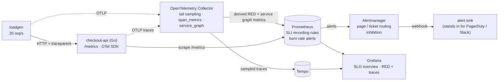

# observability-platform

[](https://github.com/GauravAnand90/observability-platform/actions/workflows/ci.yml)
[](https://github.com/GauravAnand90/observability-platform/actions/workflows/e2e.yml)


An SLO-driven observability stack you can run on a laptop with one command. It shows how I'd set up reliability signals for a production service:

- **SLOs with error budgets**, not threshold alerts: multi-window, multi-burn-rate alerting from the Google SRE Workbook
- **OpenTelemetry tracing** through a Collector with **tail sampling** (every error and every slow trace kept), stored in **Grafana Tempo**
- **Alerts that are unit-tested** with `promtool`, routed by severity (page vs ticket), each with a runbook
- **Dashboards as code**, and an **end-to-end CI test** that breaks the service and checks that the page arrives

```bash
make up      # start everything (Docker is the only requirement)
make break   # fail 30% of checkouts
             # ...within ~5 minutes SLOErrorBudgetBurnFast pages
make alerts  # see the notification Alertmanager sent
make fix
```

---

## Architecture



| Component | Role |
|---|---|
| [`app/`](app) | Go service with RED metrics, OpenTelemetry spans (`inventory.reserve`, `payment.authorize`, `order.persist`), and a fault-injection endpoint. The same binary runs the load generator and alert sink. |
| [`otel-collector/`](otel-collector/config.yaml) | Receives OTLP; tail-samples traces to Tempo; derives span metrics and a service graph for Prometheus |
| [`prometheus/`](prometheus) | SLI recording rules for 8 windows, burn-rate alerts, promtool unit tests |
| [`alertmanager/`](alertmanager/alertmanager.yml) | Severity routing, inhibition, grouping; production PagerDuty/Slack examples |
| [`grafana/`](grafana) | Provisioned datasources (Prometheus, Tempo with service map) and dashboards |
| [`docs/`](docs) | [SLO document and error-budget policy](docs/slo/checkout-api.md), [runbooks](docs/runbooks), [ADRs](docs/adr) |

## The SLOs

| SLO | SLI | Objective (30 days) |
|---|---|---|
| `checkout-availability` | Share of checkout requests not returning 5xx | **99.9%** |
| `checkout-latency` | Share of checkout requests served in ≤ 300ms | **99%** |

Defined once in [`scripts/gen_slo_rules.py`](scripts/gen_slo_rules.py), which generates [`slo-recording.yml`](prometheus/rules/slo-recording.yml). Alerts, routing and dashboards are generic over `{service, slo}`: adding an SLO means adding one entry.

## Alerting

| Alert | Condition | Severity |
|---|---|---|
| `SLOErrorBudgetBurnFast` | 14.4x burn over 1h **and** 5m, or 6x over 6h **and** 30m | page |
| `SLOErrorBudgetBurnSlow` | 3x over 1d **and** 2h, or 1x over 3d **and** 6h | ticket |
| `CheckoutTargetDown` | Prometheus can't scrape the service (the SLOs would go blind) | page |
| `SLOSignalMissing` | The SLI's source metric disappeared | ticket |

A ticket is suppressed while a page fires for the same SLO. Why burn rates instead of thresholds: [ADR 0001](docs/adr/0001-multiwindow-burn-rate-alerts.md).

## Tracing with OpenTelemetry

- The service uses the **OpenTelemetry Go SDK** with **W3C trace context**, so one trace runs from the load generator through checkout-api and its child spans.
- Configuration is entirely through standard `OTEL_*` environment variables. The app sends OTLP to the Collector and knows nothing about Tempo.
- The Collector's **tail sampler** decides per complete trace: **keep all errors, keep everything over 300ms, keep 10% of the rest**. Traces that explain an SLO burn are never dropped.
- **span_metrics** and **service_graph** run on 100% of spans before sampling, so derived metrics and Grafana's **service map** stay accurate.
- The **RED dashboard** places TraceQL tables of error and slow traces under the golden-signal graphs. From an alert you go to the dashboard, then the trace, then the failing span.

Why SLIs stay on Prometheus-native metrics while traces use OTel: [ADR 0002](docs/adr/0002-otel-traces-prometheus-slis.md).

## Run it

**Requires:** Docker with Compose v2. Nothing else; all checks run in containers.

```bash
make up          # build and start
```

| URL | What |
|---|---|
| http://localhost:3000 | Grafana: **SLO overview** is home; also **Checkout API: RED and traces** (anonymous view; admin/admin to edit) |
| http://localhost:9090/alerts | Prometheus alert states |
| http://localhost:9093 | Alertmanager |
| http://localhost:8080/metrics | Raw service metrics |

### Game day

| Command | What happens |
|---|---|
| `make break` | 30% of checkouts fail in `payment.authorize`. `SLOErrorBudgetBurnFast` (availability) pages in about 5 minutes. |
| `make slow` | Adds 400ms to every checkout. The latency SLO burns, and slow traces fill the RED dashboard. |
| `make alerts` | Shows the notifications Alertmanager sent and to which receiver |
| `make fix` | Clears the faults. Alerts resolve once the short windows recover. |

## Checks

```bash
make test        # everything below
make test-go     # go vet + unit tests (metrics exposition, fault injection, alert sink)
make test-rules  # promtool: 5 scenarios covering fast burn, slow burn, healthy, latency, scrape failure
make check       # promtool/amtool/otelcol validate, dashboard JSON, compose config
```

CI runs the same checks on every PR ([`ci.yml`](.github/workflows/ci.yml)) and fails if the generated rules are out of date. The [`e2e.yml`](.github/workflows/e2e.yml) workflow boots the whole stack, checks that metrics and traces arrive, injects a fault, and **asserts that a page reaches the alert sink**.

## Design decisions

- [0001: Alert on error-budget burn rate, using multiple windows](docs/adr/0001-multiwindow-burn-rate-alerts.md)
- [0002: OpenTelemetry for traces, Prometheus-native metrics for SLIs](docs/adr/0002-otel-traces-prometheus-slis.md)
- [0003: Route by severity; pages only for fast burns and lost signal](docs/adr/0003-alert-routing.md)

## Roadmap

- [ ] Kubernetes deployment: kube-prometheus-stack, `PrometheusRule` CRDs generated from the same SLO definitions, OTel Operator auto-instrumentation
- [ ] Logs with Loki, correlated to traces by trace ID
- [ ] Exemplars linking latency histogram buckets directly to traces
- [ ] Collector load-balancing layer (trace-ID routing) to scale tail sampling

## Author

**Gaurav Anand**: Senior SRE & Platform Engineer · CKA · CKAD · AWS SA Associate · Terraform Associate
[LinkedIn](https://www.linkedin.com/in/gaurav-anand-92767312a) · [GitHub](https://github.com/GauravAnand90)
