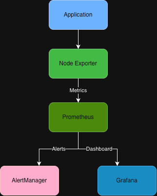

# Observability Platform

Production-grade observability platform demonstrating SRE and Platform Engineering practices.

## Tech Stack

- Prometheus
- Grafana
- AlertManager
- Docker Compose

## Architecture



## Features

- Metrics Collection
- Infrastructure Monitoring
- Alerting
- Dashboard Visualization
- Incident Detection

## Project Structure

```text
observability-platform
├── alertmanager
├── architecture
├── grafana
├── prometheus
└── docker-compose.yml
```

## Deployment

```bash
docker-compose up -d
```

## Author

**Gaurav Anand**  
Senior SRE / Platform Engineer
